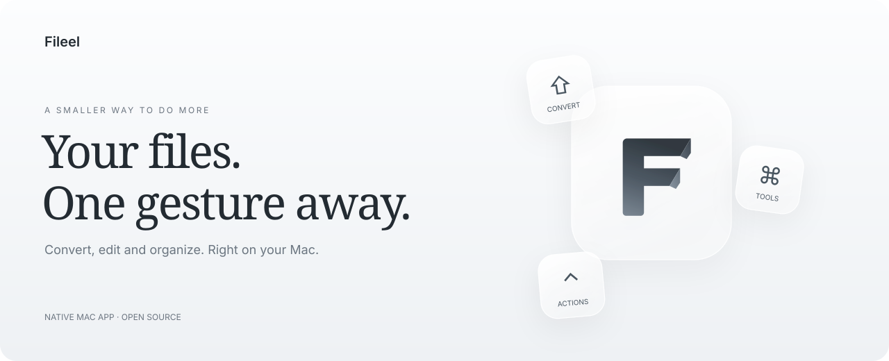

<p align="center">
  
</p>

<p align="center">
  <strong>A little less switching apps. A little more getting things done.</strong><br>
  A native, open source file utility for Apple silicon Macs
</p>

<p align="center">
  <a href="https://github.com/thiagonarcizo/Fileel/releases">Releases</a> ·
  <a href="#one-drag-three-shortcuts">How it works</a> ·
  <a href="#made-for-your-mac">Features</a> ·
  <a href="CONTRIBUTING.md">Contribute</a> ·
  <a href="https://github.com/thiagonarcizo/Fileel/issues">Feedback</a>
</p>

> **The first public release is being prepared.** Downloads will appear in [GitHub Releases](https://github.com/thiagonarcizo/Fileel/releases) after installation and update testing is complete.

## One drag. Three shortcuts.

Pick up a file in Finder and hold a key. Fileel brings the next action to your pointer.

| Hold | Choose | Make it happen |
| :---: | --- | --- |
| **⇧ Shift** | Convert | Pick a new format for your files |
| **⌘ Command** | Tools | Crop a photo, trim a clip, annotate, compress or organize a PDF |
| **⌃ Control** | Actions | Keep files floating nearby, copy a path, rename and more |

Drop onto an option to continue. Click the center or press **Esc** to close. Shortcuts can be reassigned in Settings.

## Made for your Mac

**A quiet place in the menu bar.** Fileel stays close when you need it, with no Dock icon. Its interface follows your Mac's accent color and appearance.

**Tools with room to work.** Photos, video and PDFs open in editors designed for the task. Drag crop handles, draw an arrow directly on an image, or reorder PDF pages by moving their thumbnails.

**See the size before you compress.** Choose a reduction for photos, PDFs and video before saving. Video sizes are estimates; image and PDF previews measure generated copies. Some files have less room to shrink than others.

**Keep the original.** Editing and conversion save new copies. Copy an edited image straight to the clipboard, or extract text from a photo without creating another file.

**A little tactile feedback.** Feel each selection on a compatible trackpad. Haptics and selection sounds have separate settings; sounds start off.

**Files that stay within reach.** A single floating shelf holds the files you add. Move it wherever it fits, then drag a file back into your workflow.

## A useful set of tools

| Files | A few things you can do |
| --- | --- |
| **Photos** | Convert, resize, crop, auto-adjust, annotate, redact, extract text, remove backgrounds and make collages |
| **Video** | Convert, trim, crop, resize, rotate, compress and work with audio or subtitles |
| **Audio** | Convert, trim, normalize, fade, change channels and remove silence |
| **PDFs** | Merge, split, reorder, rotate, duplicate pages, watermark, protect and compress |
| **Documents & spreadsheets** | Convert common formats and work with text or tables |
| **Archives & subtitles** | Extract, convert, verify archives and adjust subtitle formats or timing |

Conversion tools are packaged with release builds. File processing runs locally. Creating Apple Pages files additionally requires Pages and the macOS automation permission.

See the [format and acceptance checklist](docs/COVERAGE.md) for the detailed scope and current limitations, including document layout fidelity.

## Install and stay up to date

Fileel targets **Apple silicon** and **macOS 14 or later**. Native Liquid Glass is available on macOS 26 and later, with native materials on earlier systems.

Once available, open the DMG from [Releases](https://github.com/thiagonarcizo/Fileel/releases), drag Fileel into Applications, and launch it. Permission guidance appears during onboarding.

Fileel includes **Check for Updates** and automatic update checks. Stable and beta have separate update feeds; choose a channel in Settings → About. Leaving beta stops beta updates immediately and keeps your current installation until a newer stable build is available. Your preferences stay with you.

## Open source, built together

Fileel's source is available under the [MIT license](LICENSE). Ideas, bug reports and thoughtful contributions are welcome. Start with the [contributor guide](CONTRIBUTING.md) or [open an issue](https://github.com/thiagonarcizo/Fileel/issues/new).

<details>
<summary><strong>Build Fileel yourself</strong></summary>

Use Xcode 26 or newer on an Apple silicon Mac:

```sh
xcodebuild build -project Fileel.xcodeproj -scheme Fileel \
  -configuration Debug -destination 'platform=macOS,arch=arm64' \
  -derivedDataPath build CODE_SIGNING_ALLOWED=NO
```

The development app is at `build/Build/Products/Debug/Fileel.app`. Development builds can discover local conversion tools; full distribution builds package the pinned runtimes described in the [runtime build guide](docs/RUNTIME-DISTRIBUTION.md).

```sh
brew install ffmpeg-full pandoc sevenzip ghostscript
brew install --cask libreoffice
swift test
python3 -m unittest discover -s Tests/Release -v
```

Backend tests create temporary fixtures. Tests requiring an unavailable external tool report a skip; CI installs the complete tool set.

See [release automation](docs/RELEASE-AUTOMATION.md) for signing, notarization, protected branches and update publication. Bundled components retain their [upstream licenses and notices](THIRD_PARTY_NOTICES.md).

</details>
